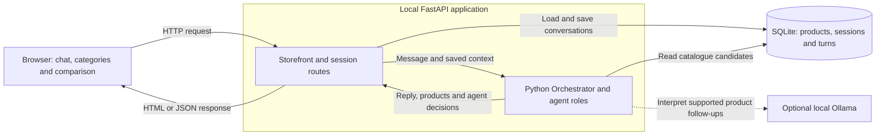

# TrailGuide

**TrailGuide is a conversational shopping assistant for outdoor and fitness gear.** It was built for **PS-12** in Agentic AI & Enterprise Automation. A shopper can say “I need a light backpack under ₹3,000,” add a weight limit or colour in a later message, and see up to three products with a side-by-side comparison. If nothing meets every requirement, TrailGuide can suggest the closest available options and explain the trade-off for each one.

[Quick start](#quick-start) · [Example conversations](#example-conversations) · [Architecture](#architecture) · [Dataset](#dataset) · [Tests](#tests)

## What it does

- **Build a search through chat.** Start with a category or a written request. TrailGuide asks for details that affect the search, such as a budget or UK shoe size, and keeps the answers as the shopper adds more requirements.
- **Compare products and understand the ranking.** See price, weight, materials, warranty, and other catalogue details. The comparison shows which requirements each product meets.
- **Get help when there is no exact match.** If a requested colour is unavailable, for example, TrailGuide can show options in other colours and flag the difference on each result.
- **Ask questions about products already shown.** Ask “What is the second one made of?” or select **Ask about this product** on a card. Follow-up answers use the product records.
- **Reopen saved conversations.** The sidebar lists saved sessions. The **Agent decisions** panel shows what the workflow understood, which checks ran, and why it asked a question or displayed a result.

TrailGuide runs locally with a fictional product catalogue. Its scope is product discovery before purchase. The core workflow uses rules for supported English requests and runs without an API key.

## Quick start

You need **Python 3.10 or later**, Git, and a web browser.

```sh
git clone https://github.com/rajat-rb-verma/TrailGuide.git
cd TrailGuide
```

On **Windows PowerShell**:

```powershell
python -m venv .venv
.\.venv\Scripts\python.exe -m pip install -r requirements.txt
.\.venv\Scripts\python.exe -m uvicorn app:app --host 127.0.0.1 --port 8000
```

On **macOS or Linux**:

```sh
python3 -m venv .venv
.venv/bin/python -m pip install -r requirements.txt
.venv/bin/python -m uvicorn app:app --host 127.0.0.1 --port 8000
```

Open [TrailGuide on localhost](http://127.0.0.1:8000/). On first launch the app creates and seeds `trailguide.sqlite3` in the project folder. It saves new chat turns to that file so you can reopen them after a restart. Click **Home** to return to the storefront or select a saved chat in the sidebar.

## Example conversations

Start a new session for each example. Send the messages in order. When the assistant asks whether you want to add anything else, type **No** or click **No, show matches**.

| Scenario | Messages or actions | What to look for |
| --- | --- | --- |
| Clarification and session memory | **Waterproof hiking boots** → **9** → **Actually, under INR 3500** → **No** | The assistant asks for UK shoe size, then remembers size 9 and waterproofing when you add the budget. |
| No exact match | **I need a backpack** → **Under 3000 rupees** → **also the weight should be light** → **the bag weight should be less than 2 kg** → **color should be red** → **No** | The assistant reports that red is unavailable for this request. The first alternative is a black 18 L daypack at ₹1,499 and 410 g. |
| Compare products after search | **Backpacks under INR 4500** → **Skip** → **No** → **Compare #1 and #3 by material and warranty** | The follow-up answer uses the first and third products already displayed in the session. |

## Architecture

TrailGuide runs as one FastAPI application. FastAPI serves the browser interface and handles the session API. The Python workflow runs inside the same process and uses a local SQLite database.



### What happens when you send a message

1. The API receives the message at `POST /api/sessions/{session_id}/turns` and loads the current shopping requirements and relevant products from earlier results.
2. The workflow extracts any supported changes. If the turn is a product question, it can answer from the relevant catalogue record. If the search needs a missing detail or confirmation, it returns a question and records what it is waiting for.
3. When the search is ready, the workflow retrieves in-stock candidates from the relevant categories, checks shipping eligibility when a region is given, and ranks candidates against the full request. Exact matches are shown first. When there are none, the fallback can show close alternatives with their trade-offs.
4. The API saves the message, reply, and agent decisions in `turns`, updates the current requirements in `sessions`, and returns the response to the browser.

### Agent roles

| Role | What it does |
| --- | --- |
| Query Ingestion | Normalizes text and records the session, turn, and input source. |
| Intent & Constraint Extraction | Reads the product category, requirements, and preferences from supported phrases. |
| Ambiguity & Clarification | Asks for missing information and checks whether the shopper is ready to search. |
| Catalog Attribute Mapping | Maps the request to product categories and catalogue fields. |
| Candidate Retrieval | Looks up in-stock products and checks shipping eligibility. |
| Ranking & Fit Scoring | Orders candidates by requirement fit, preferences, and price. |
| Explanation Generation | Uses catalogue facts to explain matches and answer product questions. |
| Zero-Result & Fallback | Looks for close alternatives and shows what each one misses. |
| Session Memory | Carries earlier requirements forward and applies changes for the current turn. |
| Orchestrator | Chooses which route each message takes and returns the response and decision trace. |

## Dataset

The [catalogue JSON](data/trailguide-catalog.json) contains **180 synthetic listings from 36 product models** in six categories: hiking footwear, trekking poles, backpacks, camping gear, hydration, and home fitness. It includes INR prices, stock, shipping regions, delivery estimates, weight, materials, warranty, and other product details. The illustrations and reviews are sample data.

The backend seeds SQLite from [catalogue code](trailguide/catalog.py) and [model specifications](trailguide/specs.py). The JSON is an export of that catalogue. You can also download the current catalogue from the running app at [the local catalogue endpoint](http://127.0.0.1:8000/api/catalog/download).

### SQLite tables

| Table | Purpose |
| --- | --- |
| `products` | Stores listing IDs, categories, stock, and detailed product records. |
| `sessions` | Stores each chat’s title, current shopping requirements, and pending clarification. |
| `turns` | Stores each message and its result, including the reply, products shown, and agent decisions. Each turn belongs to a session. |

## Optional features

- **Voice input.** Select **Dictate** in a compatible browser and allow microphone access. Review the transcript in the message box before sending. Your browser may use a remote speech service. TrailGuide receives the submitted text.
- **Local Ollama.** If Ollama is running on its default port, set `TRAILGUIDE_OLLAMA_MODEL` to a model you already have installed before starting Uvicorn. It helps map additional follow-up wording to existing product fields. The displayed facts still come from SQLite. For example, in PowerShell use `$env:TRAILGUIDE_OLLAMA_MODEL = 'qwen2.5:3b'`.

## Project structure

| Path | What you’ll find |
| --- | --- |
| [`app.py`](app.py) | FastAPI routes, database initialization, and session persistence |
| [`trailguide/agents.py`](trailguide/agents.py) | Agent roles, routing, search, ranking, and fallback |
| [`trailguide/followups.py`](trailguide/followups.py) | Catalogue-backed answers about displayed products |
| [`trailguide/model.py`](trailguide/model.py) | Optional Ollama question planner |
| [`templates/index.html`](templates/index.html) | Storefront template |
| [`static/`](static/) | Chat JavaScript, styles, and illustrations |
| [`data/`](data/) | Portable catalogue export |
| [`tests/test_workflows.py`](tests/test_workflows.py) | Automated shopping workflow checks |
| [`requirements.txt`](requirements.txt) | Python runtime dependencies |

## Tests

With the virtual environment active, run:

```sh
python -m unittest discover -s tests -v
```

The nine workflow tests cover clarification, session memory, category searches, delivery and stock filters, follow-up questions, fallback behaviour, and catalogue and image consistency.
